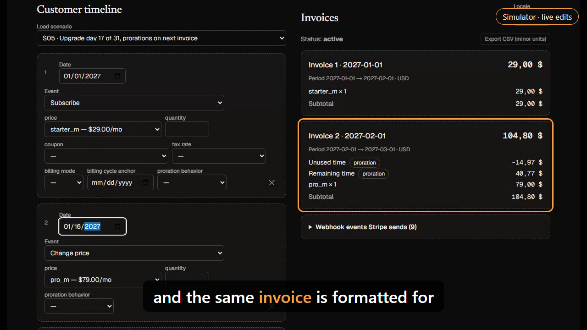
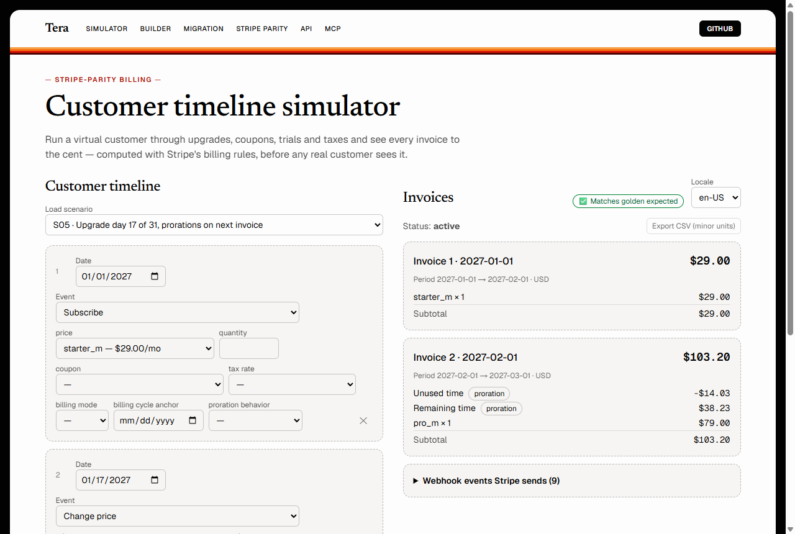
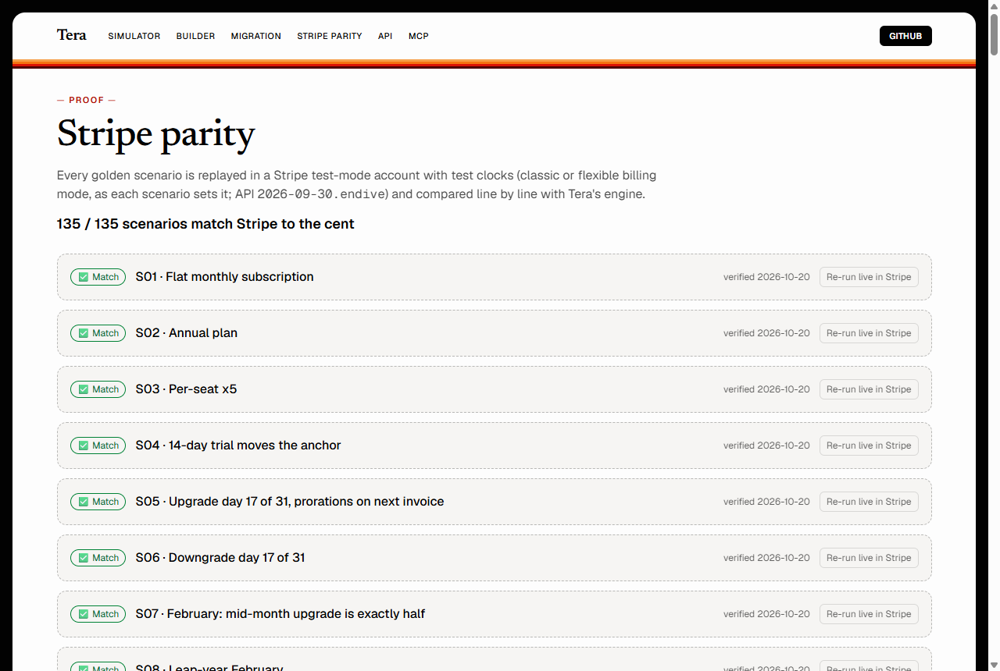

# Tera

> *Tera* (Indonesian): to officially calibrate a measuring instrument.

**Tera calibrates your pricing.** Design a plan, run a virtual customer through upgrades, trials, coupons, seats, metered usage and taxes, and see every invoice to the cent before a real customer does. Then prove it: every reference scenario is replayed in a real Stripe test-mode account and must match line by line.

- **Live:** https://tera-orpin-three.vercel.app
- **Stripe parity:** [/parity](https://tera-orpin-three.vercel.app/parity). **All 135 golden timeline scenarios match Stripe to the cent, in both classic and flexible billing mode, including Stripe's new pause and resume (API 2026-09-30.endive) and trials that end without a card.**
- **API:** [/reference](https://tera-orpin-three.vercel.app/reference) (Scalar, interactive) · [OpenAPI](https://tera-orpin-three.vercel.app/api/openapi.json)
- **MCP for AI agents:** `claude mcp add --transport http tera https://tera-orpin-three.vercel.app/api/mcp`
- **Demo video:** [`docs/tera-demo.mp4`](docs/tera-demo.mp4) (plays on GitHub) or [on X](https://x.com/BangDropID/status/2111838540552442282); built from code in [`video/`](video): Playwright records the live app, Remotion assembles it with narration
- **Write-up:** [I let Stripe grade my tests](https://dev.to/hudapugar/i-let-stripe-grade-my-tests-building-a-billing-simulator-where-no-expected-value-comes-from-my-own-4iil) (dev.to; source in [`docs/WRITEUP.md`](docs/WRITEUP.md))
- **Loop ledger:** [`docs/LOOP.md`](docs/LOOP.md), every PR and each commit's `TestSprite V3` verdict, generated from the GitHub API, including the PRs merged while the workspace was out of credits
- **PRD:** [`docs/PRD.md`](docs/PRD.md). Billing rules R1–R25, invariants I1–I6, every feature tagged SHIPPED.

[](docs/tera-demo.mp4)

| Simulator: S05, an upgrade on day 17 | Stripe parity: every golden replayed in a test clock |
|---|---|
|  |  |

## For judges: two minutes

1. Open [/simulator?s=S05](https://tera-orpin-three.vercel.app/simulator?s=S05): invoice 2 is **$103.20** (−14.03 + 38.23 + 79.00, derived by hand in [`golden/scenarios.json`](golden/scenarios.json)), with the green "Matches golden expected" badge.
2. Change any event, then press **Verify in Stripe**: the same timeline runs in a fresh Stripe test clock and is diffed to the cent.
3. Open [/parity](https://tera-orpin-three.vercel.app/parity): every golden timeline with its recorded Stripe test clock.
4. Open [`docs/LOOP.md`](docs/LOOP.md): every PR and each commit's `TestSprite V3` verdict. [PR #18](https://github.com/PugarHuda/tera/pull/18) is TestSprite catching a real bug (a custom catalog billed $0.00 instead of ¥4,500) before merge.

| Judging line | Where it shows |
|---|---|
| **Project quality** | The live app (simulator, builder, migration planner, parity, API reference, MCP setup). Lighthouse budgets of 100 for accessibility, best practices and SEO and axe WCAG 2.2 AA checks on every PR; an exploratory Playwright QA pass on production found 13 defects, all fixed with tests ([#38](https://github.com/PugarHuda/tera/pull/38)) |
| **Tests that run themselves** | On every PR: `TestSprite V3` (28 UI tests with hand-written code and exact amounts, required by branch protection) and the TestSprite API tests against the PR's own preview; Stripe parity replays for engine changes; Playwright journeys, Schemathesis, Arazzo workflows, Lighthouse. Nightly: differential fuzzing against Stripe and a TestSprite money-math canary. A CI check fails if a cloud test's plan or code drifts from the repo. See [Tests that run themselves](#tests-that-run-themselves) |
| **Innovation** | Stripe is the test oracle: expected values are hand-derived and confirmed in real Stripe test clocks, never taken from the engine; differential fuzzing turns every disagreement into a Stripe probe and a new golden; a failed TestSprite check is triaged against Stripe's recorded invoices in one PR comment; an MCP server lets coding agents simulate and verify a price change |

## Why it exists

Founders are afraid to touch pricing. A mid-cycle upgrade, a coupon or a tax rule produces invoices nobody previewed, and mistakes are found by customers on their card statements. Stripe executes billing; Tera lets you *simulate* it across customers and time first. It never moves money.

## Features

| | Feature | Where |
|---|---|---|
| FR1 | **Pricing builder**: prices in USD/EUR/GBP/JPY, coupons, tax rates, with JPY-aware validation | `/builder` |
| FR2 | **Timeline simulator**: subscriptions, trials, plan and seat changes, coupons, tax, metered usage (graduated or volume tiers, flat fees), pauses, balance adjustments and one-off charges; every invoice to the cent, proration badges, credit balance, 4 locales, CSV export, **Verify in Stripe** for your own timeline | `/simulator` (old `/?t=` and `/?s=` links redirect there) |
| FR3 | **Migration planner**: MRR impact, grandfathering, annual prices, "who pays more", CSV import/export, and **import from Stripe** (the live subscriptions on a price in the connected test-mode account) | `/migrate` |
| FR4 | **Stripe parity**: golden scenarios replayed with Stripe test clocks, with Tera and Stripe shown side by side and a live re-run | `/parity` |
| FR5 | **Two-way Stripe sync**: push the catalog's products, prices, coupons and tax rates to test mode, idempotently, or **import the account's existing catalog** into the builder and simulate on it | `/builder` |
| FR6 | **Shareable links**: the timeline (and custom catalog) travel in the URL | "Copy share link" |
| FR7 | **Public REST API** with 400/422/404 semantics, CORS-enabled for browser apps | `/api/simulate`, `/api/migrate`, `/api/scenarios`, `/api/parity`, `/api/stripe/push`, `/api/stripe/catalog` |
| FR8 | **MCP server**: 10 tools (with typed `outputSchema` and `structuredContent` on the data tools, tested over the wire with the official MCP client SDK in [`mcp.test.ts`](src/lib/mcp.test.ts)) (`simulate_timeline` and `verify_timeline_in_stripe` with custom catalogs, `plan_price_migration`, `plan_stripe_price_migration`, `push_catalog_to_stripe`, `import_stripe_catalog`, `create_share_link`, `get_parity_evidence`, golden scenario tools), 4 resources (`tera://catalog`, `tera://openapi.json`, `tera://parity`, `tera://scenarios/{id}`), 2 prompts (`explain_invoice`, `audit_price_change`) | `/api/mcp`, `/mcp-setup` |
| FR9 | **Interactive API reference** | `/reference` |
| FR10 | **Webhook events**: every timeline also lists the webhook events Stripe sends for it (`invoice.created/finalized/paid`, `customer.subscription.*`, `invoiceitem.created`), per event and dated, each naming the invoice it is about or the subscription status it carries, so a webhook handler can be tested against the real sequence. Recorded from test clocks for all 135 golden timelines and matched event for event. After **Verify in Stripe**, the events the test clock really sent download as JSON with their full payloads, and [`replay-webhooks.mjs`](public/replay-webhooks.mjs) posts them to your endpoint signed with your `whsec_` secret exactly as Stripe signs them (checked against Stripe's own `constructEvent`) | `/simulator` ("Webhook events Stripe sends"), `webhooks` in `/api/simulate`, MCP |

## How correctness is established

1. **Rules first.** [`docs/PRD.md`](docs/PRD.md) states each billing rule, for example R3 proration: `−round(old × remaining / period)` and `+round(new × remaining / period)`.
2. **Golden scenarios by hand.** [`golden/scenarios.json`](golden/scenarios.json) holds 138 scenarios. Their expected invoices are derived by hand, with the math written next to them. They are **never** generated by the engine.
3. **Stripe is the oracle.** [`scripts/verify-golden.mts`](scripts/verify-golden.mts) replays every timeline scenario in Stripe test mode. It uses test clocks, classic billing mode, API `2026-09-30.endive`, and Stripe Meters for usage. It diffs date, lines, subtotal, discount, tax, total, starting balance and amount due. Matches are marked `verified`, and the evidence (invoice ids, test clock) is committed in [`golden/parity/`](golden/parity).
4. **Stripe corrected us, and we kept the receipts:**
   - **S11:** a coupon applied in the same second as subscribing discounts the *next* invoice. Stripe finalizes the first invoice at creation.
   - **S21:** new subscriptions default to *flexible* billing mode. Tera models *classic*, and that is now rule R12.
   - **S30–S34:** a custom timeline sent through **Verify in Stripe** exposed two engine bugs. A credit after a used-up `once` coupon refunds the discounted price actually paid, and `change_price` without a quantity resets seats to 1 (R13). Our hand derivation of S33 was wrong too, and Stripe fixed it.
5. **Differential fuzzing.** [`scripts/fuzz-parity.mts`](scripts/fuzz-parity.mts) generates seeded random timelines (month-end anchors incl. Feb 29, random times of day, trials, seat and plan changes, interval switches, percent and amount_off coupons, inclusive and exclusive tax, cancellations, USD and JPY) and replays each in Stripe. The first 60 timelines found **7 rule gaps** that 31 hand-written scenarios had missed. Each gap was confirmed with a targeted Stripe probe ([`scripts/probe-stripe.mts`](scripts/probe-stripe.mts)) and pinned as a hand-derived golden (S35–S42). All 60 now match. Its **first nightly CI run found an 8th** (S43, a no-op `always_invoice` change still invoices pending prorations). The engine then grew four more Stripe actions (`proration_behavior: none`, ending a trial early, undoing a scheduled cancel, cancelling immediately); a probe showed Stripe credits the *current* item after an unprorated change, not what was paid (R14), and each action is pinned as a verified golden (S44–S49) and fuzzed nightly. The next 30 fuzzed timelines found that a `repeating` coupon lasts its months in calendar time, not a count of invoices (S50). Two more actions, resetting the billing anchor (`billing_cycle_anchor: now`) and removing a coupon, came with Stripe probes (R15, S51–S53), plus S54 guarding a credit after two interval changes under an `amount_off` coupon. The next fuzz batch found a 1-cent diff on a credit of exactly 11257.5: Stripe prorates the *unit* price to 12 decimals before multiplying by seats, so 5003.333333333333 × 3 × 75% lands just under the tie (S55, S56, after four targeted probes). The batch after that found a coupon applied at the exact renewal instant: Stripe copies the discount onto the renewal draft when it creates it, so the coupon starts with the next invoice (S57). Then **flexible billing mode**, Stripe's default for new subscriptions since 2025, which Tera had not modelled: replaying all 54 classic goldens with `billing_mode: flexible` made 16 differ, and the differences give R16 (credits refund each original debit with gross and discount rounded apart, the anchor never resets on an interval change, an anchor reset nets out). Eight hand-derived flexible goldens (S58–S65) are verified, and the fuzzer takes a mode (`fuzz-parity.mts 60 40000 flexible`). Its first flexible batch found one more cent: a proration debit is credited from its rounded gross and rounded discount, not its net (S66). Then refunds on immediate cancellation (Stripe `prorate` + `invoice_now`, R17): probed in both modes, pinned as S67 and S68, and half of the fuzzer's immediate cancellations now ask for one. The second flexible fuzz batch found two more: an amount due under Stripe's 50-cent minimum is carried to the next invoice instead of charged (R18, S69, both modes), and after a `none` yearly → monthly change a later credit stops at the monthly period end (S70). Cancelling on a date (`cancel_at`, R19) came with ten probes across both modes: a final credit inside the period, a shortened last renewal in a later one (S71–S73). Billing on a fixed day (`billing_cycle_anchor` at creation, R20): the stub before the first billing date is prorated over the period that ends on it, one interval counted from the start (S74–S76). The next fuzz batch, aimed at the new actions, found three more: that interval is counted from the start even at month end (S77), a coupon-free debit is still credited as a $0 line (S78), and a percent discount on a proration comes off the rounded gross, 7135.5 → 7136 (S79). Pause and resume (R21), new in Stripe API 2026-09-30.endive, came with five probes: the credit waits for the resumption invoice by default, is its own credit invoice with `invoicing_behavior: invoice`, and an unchanged anchor bills the rest of the cycle at the next renewal (S80–S84); the flexible fuzzer now pauses and resumes a third of its subscriptions. Its first batch (36 timelines) found five more: a flexible first-billing-date stub divides by the period ending on the anchor, not one interval from the start (S85, three seeds); resuming in the period of an unprorated change charges nothing (S86, S87); and the resume charge takes its discount off the unrounded gross (S88). The second batch (40) found five more: in flexible mode every proration discount comes off the unrounded gross (S89) and a credit refunds its original debit's tax, a yen at a tie (S93); time an uncredited debit still pays for is not charged again on resume (S91, S92); classic inclusive tax rounds a tie half up (S90). The fifth, a month-end anchor resumed unchanged, has no rule that fits Stripe's number yet, so Tera rejects it rather than guess (documented in R21). The third batch (40 flexible, plus 24 classic as a regression check: 24/24) found three more: flexible exclusive tax is one computation on the total, only inclusive tax is per line (S94), and a renewal claims a `once` coupon when it is drafted, so a plan change at that instant is not discounted by it (S95). Trials that end without a card (Stripe `trial_settings.end_behavior.missing_payment_method`, R22) came with eleven probes: canceled or paused at trial end with nothing invoiced, and a classic subscription resumable only with its old anchor because Stripe voids the invoice an anchor reset creates (S96–S99). The fuzzer gained a `nocard` mode (`fuzz-parity.mts 24 70001 classic nocard`); its first 72 timelines found that the resume charge uses up a `once` coupon, even one that makes it free (S100, S101, four seeds), and two classic inclusive-tax ties a cent under Stripe that no rounding rule explains together with S79 and S90, documented in R6 as an open question rather than guessed. The next 72 (both modes) found a flexible interval change before the first billing date aligned to the wrong period, so the renewal on that date was missing (S102), plus three more one-cent inclusive-tax cases. Those cents were finally explained by Stripe's own docs: this account rounds tax at the **invoice level**, summing each line's taxable amount to 12 decimals before applying the rate and rounding once ([tax rate rounding](https://docs.stripe.com/billing/taxes/tax-rates#rounding)). Replaying the 29 timelines where the earlier rules disagreed, the new rule matches 28 (R6). Customer balance adjustments (R23, S103, S104) are the latest action, and the fuzzer now adds them to a third of its timelines. Its first 60 such timelines found two more: Stripe finalizes a renewal draft an hour after creating it, so a change in that hour is finalized first and moves the balance (S105), plus two coupon-priced flexible tax cents. The next 60 found that a first-billing-date stub made free by a coupon is still a $0 invoice that uses the coupon up (S106), and an interval round trip after a `none` change that Tera now rejects rather than guess. One long-standing rejection is now modelled: resuming with an unchanged month-end anchor, where Stripe prorates in monthly segments (7/30 + 1/31, not 8/31; S107, five live probes), and a flexible anchor reset now uses up a `once` coupon like every other remaining-time charge (S108). The last tax cents fell to a replay study: at an exact half cent Stripe keeps each line's tax to 12 decimals, cut toward zero on a positive invoice and down on a negative one (S109, S110); that rule matched all 24 replays where it disagreed with the previous one, and closed coupon seed 79030. The same replays turned up a renewal that canceling finalizes first (S111) and a free coupon stub credited at full price (S112). The next 80 fuzzed timelines found three more: a month-end first billing date prorates its stub in monthly segments like a month-end resume (S113), a pause with nothing to credit opens no invoice (S114), and a `none` anchor reset counts its period as paid on resume (S116); the new rules matched 15 of the 16 replays where they changed the result, and the sixteenth exposed S116. Two long-standing rejections are now modelled from Stripe probes: resuming exactly on a billing date (S115) and applying a coupon while paused (S117). A fourth finding, one cent on a credit that is an exact half-cent tie, is documented as open (R16): two plausible rules fit its seed (per-seat rounding, credit = debit − used part) and were dropped after losing 13 of 19 and 12 of 12 replays. Usage-based billing got the same treatment after a code audit showed the engine silently dropped metered usage on a price switch and on an immediate cancellation: seven Stripe probes gave the rules (tier lines only up to the tier the usage reaches, no unused-time line for a metered item, `invoice_now` bills the usage so far, flexible mode rejects a metered/licensed switch), pinned as S118–S124; volume tiers and tier flat fees followed (S125–S129), and the first metered fuzz batch found a $0 final invoice Stripe sends after an unused last period (S130) plus a stale usage window in the replay itself; the fuzzer gained a `metered` mode (`fuzz-parity.mts 8 1 classic metered`). It runs nightly in [`stripe-parity.yml`](.github/workflows/stripe-parity.yml) with fresh seeds. The same workflow replays every golden scenario in Stripe on any PR that touches the engine.
6. **Verify your own timeline.** "Verify in Stripe" in the simulator, or `POST /api/parity { timeline, catalog? }`, replays *any* timeline (up to 15 events, 2 years) in a fresh Stripe test clock and diffs it to the cent, and its webhook events type for type.
7. **Webhook events, from the same test clocks.** The replay also reads the events Stripe sends after each step (R24). Recording them for all 135 golden timelines gave the rules, some of them undocumented: a renewal's `invoice.finalized`/`invoice.paid` arrive an hour after `invoice.created`, so a timeline that ends on a renewal has only the draft; a cancellation's final invoice is finalized an hour later too; an invoice made while pausing is finalized but never paid; `cancel_at` inside the period creates its credit item at once. Tera matches all 135 recordings ([`src/lib/webhooks.test.ts`](src/lib/webhooks.test.ts)) and the fuzzer compares webhooks on every timeline. Fuzzing also showed what *not* to model: `customer.discount.*` events depend on the real date, not the clock's (a test clock dated in the past gets extra `deleted` events for discounts still applied), so they are left out rather than fitted to the artefact.

## Tests that run themselves

| Layer | What runs | When |
|---|---|---|
| Unit (Vitest) | Engine vs all golden scenarios; invariants I1 (totals add up, integer money), I2 (credit ≤ paid), I5 (deterministic), I6 (amount due ≥ 0), checked on the goldens **and on 5,000 seeded random timelines** (credit carried invoice to invoice, rejections are reasons not crashes); Stripe-rejected timelines; CSV and share-link parsing | `npm test` |
| **TestSprite UI** (GitHub App) | Plans that assert exact amounts in the browser: golden badge, edits, out-of-order dates, locales, credit balance, trial changes, migration math, parity page, builder, MCP page | **Every PR** against its Vercel preview; branch protection requires `TestSprite V3` |
| **TestSprite API** (CLI in Actions) | Golden contract (every scenario through `/api/simulate`, to the cent); R10/R11 behaviour; 400/422/404; parity evidence | **Every PR** against its Vercel preview, every push to `main` against production, nightly. TestSprite gives backend tests no target URL, so [`testsprite-api-run.mjs`](scripts/testsprite-api-run.mjs) stores each test with its base URL pointing at the deployment, runs it and puts production back ([`.github/workflows/testsprite-api.yml`](.github/workflows/testsprite-api.yml)) |
| **TestSprite triage** (failure bundles × Stripe) | When `TestSprite V3` fails on a PR, [`testsprite-triage.mjs`](scripts/testsprite-triage.mjs) downloads each failed run's bundle (failed step, root-cause hypothesis), runs the golden scenarios behind that test through the same preview's engine and compares them with the Stripe test-clock invoices: one PR comment says **engine still matches Stripe → UI regression**, or which invoice the engine now gets wrong | Every failed TestSprite check ([`testsprite-triage.yml`](.github/workflows/testsprite-triage.yml)); no credits used |
| **TestSprite schedule** (test list) | `Money math canary`: the four tests that assert Stripe-verified amounts (S05 totals, the $104.80 edit, credit balance, S27's credit) | Nightly on production at 03:00 UTC; the list and schedule are declared in [`testsprite/suite.json`](testsprite/suite.json) and checked like the plans
| Stripe parity | Every golden scenario replayed in real Stripe test clocks | Every PR touching the engine (`stripe-parity.yml`), `node scripts/verify-golden.mts --mark`, live from `/parity` |
| Differential fuzzing | 24 fresh random timelines per billing mode (classic and flexible), Tera vs Stripe | Nightly (`stripe-parity.yml`), `node scripts/fuzz-parity.mts [count] [seed] [classic\|flexible]` |
| **Schemathesis** (API fuzzing from the OpenAPI spec) | Property-based requests generated from `/api/openapi.json` (2,000+ per run locally): schema-valid ones must succeed or be a documented 422, schema-invalid ones must be a 400, never a 500, and every response must match the spec. Its first runs found the spec looser than the API and five inputs the validator let through (an unknown `usage_type`, a non-string `price` on events that ignore it, a fractional `amount`, `[null]` as the first event, preflight advertising the 405 stubs). Contract: **400 = breaks the published schema, 422 = schema-valid but not billable** | **Every PR** against its preview and every push to `main` ([`e2e.yml`](.github/workflows/e2e.yml), [`schemathesis.toml`](schemathesis.toml)) |
| **Redocly** (OpenAPI lint) + **Lighthouse CI** | Redocly lints the deployed spec (operation ids, servers, security, response schemas for every GET, so Schemathesis checks those responses too; rules in [`redocly.yaml`](redocly.yaml)). Lighthouse runs five pages three times: accessibility, best practices and SEO must score 100, performance at least 70 on the shared runner, CLS under 0.1 ([`lighthouserc.json`](lighthouserc.json)). Its first run found the simulator's loading fallback shifting the footer (CLS 0.136, now 0) | **Every PR** against its preview and every push to `main` ([`e2e.yml`](.github/workflows/e2e.yml)) |
| **Arazzo workflows** (Redocly Respect) | Stateful API contract tests in [`api-workflows/tera.arazzo.yaml`](api-workflows/tera.arazzo.yaml): a client finds S05 by rule and title, fetches its hand-derived invoices and replays the timeline through `/api/simulate`, and the engine's totals are compared with the fetched ones and with the S05 math (−1403, 3823, 7900, $103.20, the `invoice.created` webhook for invoice 2); a $29 → $39 price increase with and without grandfathering, and annual MRR; the 400/422/404 contract; parity evidence for every timeline. Every response is also validated against the deployed spec. Respect treats undeclared properties as errors in every subschema, so CI marks the conditional branches of the downloaded spec explicitly ([`respect-spec.mjs`](api-workflows/respect-spec.mjs)); the served spec stays plain so Schemathesis can still generate cases from it | **Every PR** against its preview and every push to `main` ([`e2e.yml`](.github/workflows/e2e.yml)) |
| **Playwright user journeys** | A user who only clicks, types (dates key by key), picks from dropdowns, picks a CSV file and downloads one: builds a flexible fixed-billing-day timeline from scratch, shares it, exports it, switches locale, **verifies it live in Stripe**; adds a price in the builder and bills it; runs the migration planner with grandfathering and a CSV import; opens Stripe evidence on `/parity`; MCP and API pages. Expected amounts are hand-derived. Its first run caught two real bugs: typing a date froze the tab (year 0202 = 21,901 renewals), then the guard ate the keystrokes | **Every PR** against its Vercel preview and every push to `main` against production ([`e2e.yml`](.github/workflows/e2e.yml), run video kept as an artifact), `node e2e/user-journeys.mjs <url>` |

The TestSprite suites are versioned as code in [`testsprite/`](testsprite): UI plans in `plans/*.json` and API tests in `api/*.py`. Each one is created with `testsprite test create`.

**What a green check means:** every golden invoice still matches to the cent in every currency, through the UI and the API, and the API still rejects what Stripe rejects.

### Bugs TestSprite and Stripe caught (red, then green)

| PR | Caught by | Bug |
|---|---|---|
| #2 | TestSprite UI SIM-004 | The golden badge never came back after an edit was reverted |
| #4 | Adversarial engine probe | A trial upgrade credited unpaid trial time; a downgrade produced a negative invoice instead of a credit balance; foreign-currency coupons were accepted |
| #8 | Stripe test clocks | S11 same-instant coupon; S21 billing mode |
| #9 | Stripe proration docs | percent_off coupons were re-applied to proration lines |
| #11 | Playwright QA + axe-core | Metered prices dropped by the builder; WCAG contrast on badges |
| #17 | Nightly fuzzing in CI (its first run) | A no-op change with `always_invoice` must still invoice earlier pending prorations |
| #16 | Differential fuzzing vs Stripe (60 random timelines) | amount_off coupons ignored in proration credits; a `once` coupon is used up by the proration it prices; no tax on negative invoices; prorations dropped at cancellation instead of a final invoice; an `always_invoice` change at the renewal instant **erased the renewal invoice**; same-price or same-quantity changes prorated; a 1-cent rounding difference on percent-coupon prorations; a "-$0.00" credit line |
| #19 | Fuzzing with anchor reset / coupon removal | A seat-change credit of exactly x.5 cents rounded up where Stripe, prorating the unit price to 12 decimals first, rounds down (66162 vs 66163); a coupon applied at the renewal instant discounted that renewal instead of the next one |
| #18 | Differential fuzzing with the new actions | A `repeating` coupon was counted in invoices instead of calendar months, so a yearly → monthly switch lost discounted renewals; `proration_behavior` was never validated |
| #14 | Live "Verify in Stripe" of a custom timeline | A credit after a used-up `once` coupon refunded full price instead of the price paid; `change_price` kept seats where Stripe resets them to 1 (R13); the hand-derived S33 credit was wrong |

## Develop

```bash
npm install
npm run dev                                  # http://localhost:3000
npm test                                     # engine vs golden scenarios + invariants
node scripts/verify-golden.mts --mark        # replay in Stripe test mode (needs STRIPE_SECRET_KEY=sk_test_… in .env.local)
TERA_BASE_URL=http://localhost:3000 python testsprite/api/golden_contract.py
```

Stack: Next.js 16 (App Router, Cache Components), React 19, TypeScript, Tailwind 4, Vitest, `stripe@23`, `mcp-handler@2`, Vercel.
